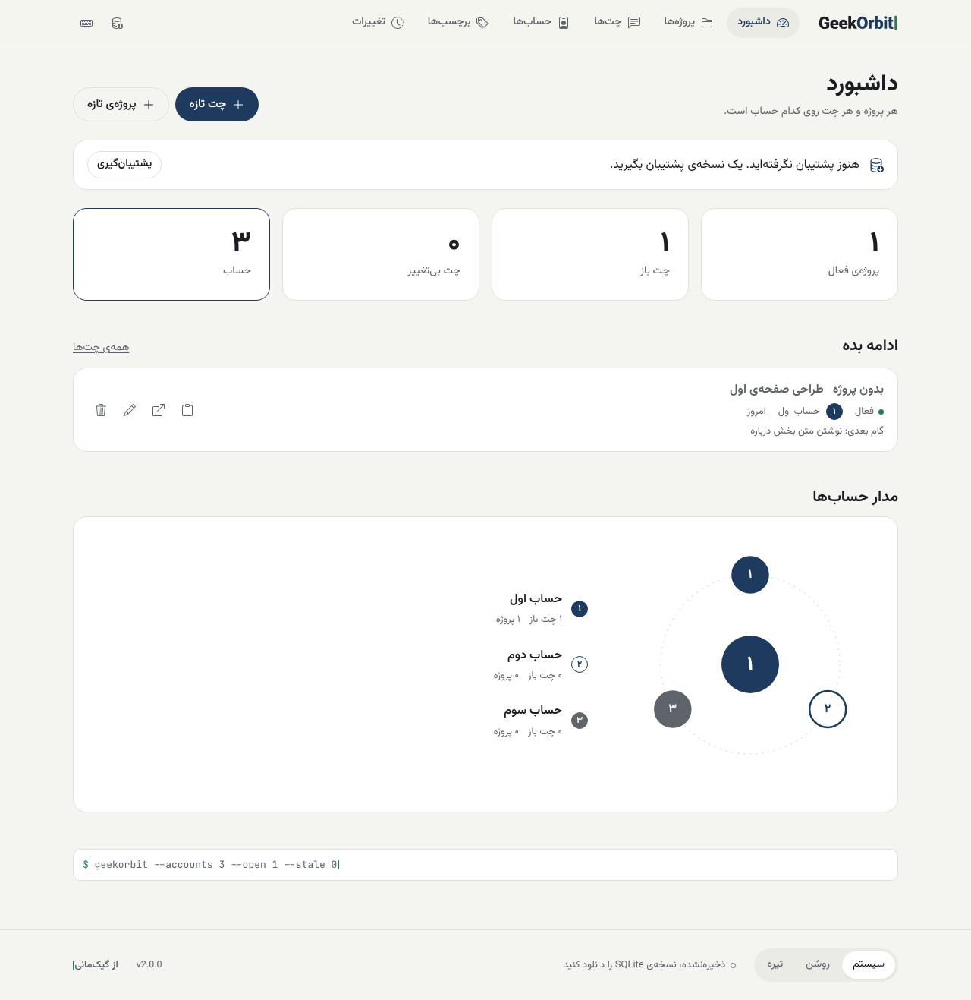

<p align="center">
  
</p>

<h1 align="center">GeekOrbit</h1>

<p align="center" dir="rtl">داشبورد محلی و آفلاین که نشان می‌دهد هر پروژه و هر گفت‌وگو روی کدام‌یک از حساب‌های چت‌بات هوش مصنوعی شماست.</p>
<p align="center">A local, offline dashboard that shows which of your AI chatbot accounts each project and conversation lives on.</p>

<p align="center"><a href="https://mani-imani.github.io/GeekOrbit/"><b>mani-imani.github.io/GeekOrbit</b></a></p>
<p align="center"><a href="#فارسی">فارسی</a> · <a href="#english">English</a> · <code>v2.1.0</code></p>

<p align="center"></p>

---

<div dir="rtl">

## فارسی

### چه کاری می‌کند
- حساب‌ها، پروژه‌ها و چت‌ها را در یک فایل <bdi>SQLite</bdi> روی دستگاه خودتان نگه می‌دارد.
- در داشبورد نشان می‌دهد کدام چت‌ها باز مانده‌اند و کدام‌ها مدتی است دست نخورده‌اند.
- برای هر چت یک یادداشت تحویل می‌سازد تا در یک گفت‌وگوی تازه از همان‌جا ادامه دهید.
- پیوند تکراری، حساب محدودشده و زمان پشتیبان‌گیری را یادآوری می‌کند.
- تاریخ‌ها شمسی نمایش داده می‌شوند. هیچ داده‌ای به جایی فرستاده نمی‌شود.

### چرا ساخته شد
وقتی چند حساب چت‌بات دارید، پیدا کردن این‌که فلان گفت‌وگو کجا بود کم‌کم وقت‌گیر می‌شود. <bdi>GeekOrbit</bdi> این را در یک نگاه نشان می‌دهد.

### اجرا
ساده‌ترین راه، نسخه‌ی آنلاین است: [mani-imani.github.io/GeekOrbit](https://mani-imani.github.io/GeekOrbit/). برنامه کاملاً داخل مرورگر اجرا می‌شود و داده‌ها فقط در فایلی روی دستگاه خودتان ذخیره می‌شوند. با «اول با داده‌ی نمونه امتحان کنید» هم می‌توانید بدون ساختن فایل، برنامه را ببینید.

برای اجرای محلی: برنامه ایستا است، ولی مرورگر <bdi>WebAssembly</bdi> را از روی <code dir="ltr">file&#58;//</code> بارگذاری نمی‌کند؛ پس یک سرور ساده‌ی محلی لازم است:

<div dir="ltr">

```bash
cd GeekOrbit
python3 -m http.server 8000
# then open http://localhost:8000
```

</div>

### استفاده
1. «ساخت پایگاه داده‌ی تازه» را بزنید و جای فایل را انتخاب کنید، یا فایل موجود را باز کنید.
2. در بخش حساب‌ها، حساب‌هایتان را ثبت کنید.
3. پروژه و چت بسازید. تغییرها خودکار در همان فایل ذخیره می‌شوند.

ذخیره‌ی خودکار در <bdi>Chrome</bdi> و <bdi>Edge</bdi> کار می‌کند. مرورگرهای دیگر فایل را فقط می‌خوانند؛ در آن‌ها از «پشتیبان و خروجی» نسخه‌ی <bdi>SQLite</bdi> را دانلود کنید.

### میانبرهای صفحه‌کلید
| کلید | کار |
| --- | --- |
| <kbd>N</kbd> | چت تازه |
| <kbd>P</kbd> | پروژه‌ی تازه |
| <kbd>/</kbd> | رفتن به جست‌وجو |
| <kbd>1</kbd> تا <kbd>6</kbd> | رفتن به بخش‌ها |
| <kbd>?</kbd> | فهرست میانبرها |

میانبرها روی صفحه‌کلید فارسی هم کار می‌کنند.

### ارتقا از نسخه‌ی ۱
فایل نسخه‌ی ۱ را باز کنید. برنامه پیش از به‌روزرسانی پیشنهاد می‌دهد یک نسخه‌ی پشتیبان بگیرید و بعد ساختار فایل را یک بار به‌روز می‌کند: جدول‌ها و ستون‌هایی را که نیست می‌سازد، وضعیت‌های قدیمی را به وضعیت‌های تازه برمی‌گرداند و پیوندهای بی‌صاحب را پاک می‌کند. ستون رنگ حساب‌ها دیگر استفاده نمی‌شود، ولی حذف هم نمی‌شود.

### ساختار پروژه
<div dir="ltr">

```
GeekOrbit/
├── index.html
├── js/                 برنامه (ماژول‌های ES، بدون فریم‌ورک)
│   └── views/          صفحه‌ها
├── css/geek.css        سیستم طراحی GeekMani (بدون تغییر)
├── css/geekorbit.css   ظاهر GeekOrbit
├── vendor/             sql.js، موتور SQLite برای مرورگر (MIT)
├── fonts/              Vazirmatn و JetBrains Mono (OFL)
├── assets/             آیکون، wordmark و آیکون‌های Bootstrap (MIT)
├── scripts/            ساخت js/icons.js از آیکون‌ها
└── docs/               تصویر برنامه
```

</div>

### مجوز
کد با مجوز <bdi>MIT</bdi> (فایل <code dir="ltr">LICENSE</code>). <bdi>sql.js</bdi> و آیکون‌های <bdi>Bootstrap</bdi> مجوز <bdi>MIT</bdi> و فونت‌ها مجوز <bdi>SIL OFL</bdi> دارند؛ فایل مجوز هر کدام کنار خودش است.

### نسخه
<code dir="ltr">v2.1.0</code> · تاریخچه در [CHANGELOG.md](CHANGELOG.md).

</div>

---

## English

### What it does
- Keeps your accounts, projects and chats in one SQLite file on your own device.
- The dashboard shows which chats are still open and which haven't been touched for a while.
- Builds a handoff note for any chat, so you can continue in a fresh conversation.
- Warns about duplicate links, rate-limited accounts and overdue backups.
- Dates are shown in the Persian (Jalali) calendar. No data is sent anywhere.

### Why
With several chatbot accounts, finding where a conversation lives slowly eats time. GeekOrbit shows it at a glance.

### Run
The easiest way is the online version: [mani-imani.github.io/GeekOrbit](https://mani-imani.github.io/GeekOrbit/). The app runs entirely in your browser and your data is saved only to a file on your own device. «اول با داده‌ی نمونه امتحان کنید» (try it with sample data) opens it without creating a file.

To run it locally: the app is static, but browsers don't load WebAssembly from `file://`, so serve the folder locally:

```bash
cd GeekOrbit
python3 -m http.server 8000
# then open http://localhost:8000
```

### Use
1. Click «ساخت پایگاه داده‌ی تازه» (new database) and choose where to save it, or «باز کردن فایل موجود» (open an existing file). The interface is in Persian.
2. Add your accounts under «حساب‌ها» (accounts).
3. Create projects and chats. Changes are saved to the same file automatically.

Automatic saving works in Chrome and Edge. Other browsers only read the file; there, download the SQLite copy from «پشتیبان و خروجی» (backup and export).

### Keyboard shortcuts
| Key | Action |
| --- | --- |
| <kbd>N</kbd> | new chat |
| <kbd>P</kbd> | new project |
| <kbd>/</kbd> | go to search |
| <kbd>1</kbd>–<kbd>6</kbd> | go to a section |
| <kbd>?</kbd> | list of shortcuts |

Shortcuts also work on the Persian keyboard layout.

### Upgrading from v1
Open your v1 file. The app offers a backup first, then updates the file once: it creates any missing tables and columns, maps old statuses to the new ones and removes orphaned links. The old account colour column is no longer used but is kept.

### Project structure
```
GeekOrbit/
├── index.html
├── js/                 the app (ES modules, no framework)
│   └── views/          pages
├── css/geek.css        GeekMani design system (unchanged)
├── css/geekorbit.css   GeekOrbit styles
├── vendor/             sql.js, SQLite for the browser (MIT)
├── fonts/              Vazirmatn and JetBrains Mono (OFL)
├── assets/             icon, wordmark and Bootstrap Icons (MIT)
├── scripts/            builds js/icons.js from the icon files
└── docs/               screenshot
```

### License
Code under the MIT license (see [LICENSE](LICENSE)). sql.js and Bootstrap Icons are MIT; the fonts are SIL OFL. Each license file sits next to its files.

### Version
`v2.1.0` · see [CHANGELOG.md](CHANGELOG.md).

---

<p align="center"><a href="https://github.com/mani-imani"><b>by GeekMani</b></a> · <a href="https://github.com/mani-imani">از گیک‌مانی</a> · <a href="https://maniimani.ir">maniimani.ir</a></p>
